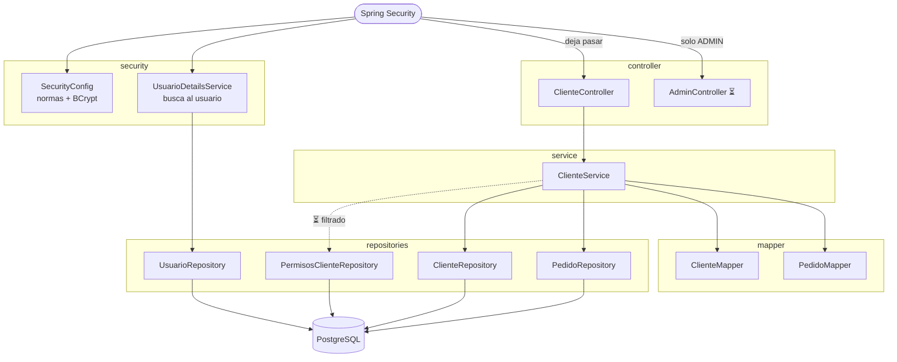
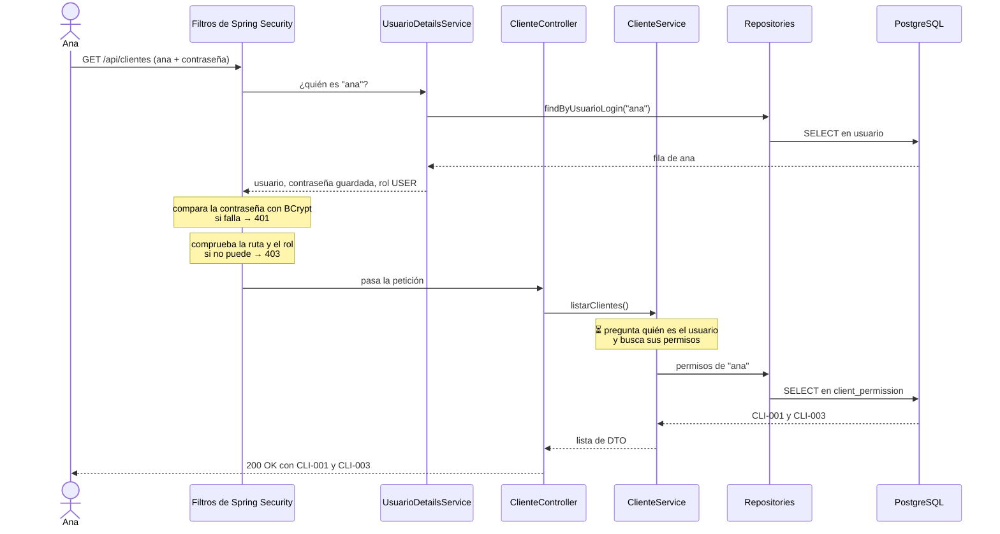
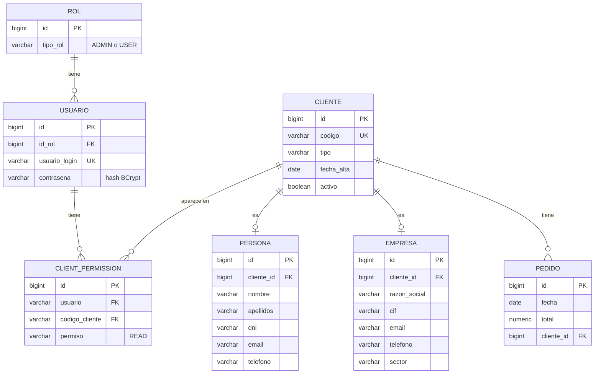

# Apuntes: arquitectura de la API y quién llama a quién

Apuntes orientativos. No forman parte de la entrega.

Leyenda: ✅ hecho · ⏳ pendiente

**Índice**

1. [Vista general por capas](#1-vista-general-por-capas)
2. [Quién llama a quién](#2-quién-llama-a-quién)
3. [Las piezas de seguridad](#3-las-piezas-de-seguridad)
4. [Recorrido de una petición](#4-recorrido-de-una-petición)
5. [Tablas y relaciones](#5-tablas-y-relaciones)
6. [De la tabla a la clase](#6-de-la-tabla-a-la-clase)

---

## 1. Vista general por capas

**Idea:** la petición baja capa a capa hasta la base de datos y la respuesta sube por el mismo camino. La seguridad es una puerta delante de todo.

```
   Cliente (curl, navegador)
            │  petición HTTP con usuario y contraseña
            ▼
┌───────────────────────────┐
│  SEGURIDAD  (security)    │  ¿Quién eres? ¿Puedes entrar en esta ruta?
└───────────────────────────┘        ✗ → 401 / 403
            │ ✓
            ▼
┌───────────────────────────┐
│  CONTROLLER               │  Recibe la petición y devuelve la respuesta
└───────────────────────────┘
            ▼
┌───────────────────────────┐
│  SERVICE  (+ mapper)      │  La lógica: qué datos puede ver este usuario
└───────────────────────────┘
            ▼
┌───────────────────────────┐
│  REPOSITORIES             │  Van a las tablas a buscar y guardar
└───────────────────────────┘
            ▼
┌───────────────────────────┐
│  PostgreSQL               │  basededatos
└───────────────────────────┘
```

| Capa | Paquete | Pregunta que responde |
|---|---|---|
| Seguridad | `security` | ¿Quién eres y a qué rutas puedes entrar? |
| Controller | `controller` | ¿Qué ruta se ha pedido? |
| Service | `service` | ¿Qué hay que hacer y qué datos tocan a este usuario? |
| Mapper | `mapper` | ¿Cómo se convierte una entidad en DTO? |
| Repositories | `repositories` | ¿Cómo se buscan los datos en la tabla? |
| Entity | `entity` | ¿Qué forma tiene cada fila en Java? |
| DTO | `dto` | ¿Qué datos se envían y se reciben en JSON? |

> **Para recordar:** cada capa solo habla con la de abajo. El controller nunca toca la base de datos.

---

## 2. Quién llama a quién

**Idea:** las flechas se leen "usa a". Arriba, lo que ya existía; a la izquierda, lo nuevo de seguridad.



| Quién | Usa a | Para qué | Estado |
|---|---|---|---|
| Spring Security | `SecurityConfig` | Leer las normas y cómo comparar contraseñas | ✅ |
| Spring Security | `UsuarioDetailsService` | Saber quién intenta entrar | ✅ |
| `UsuarioDetailsService` | `UsuarioRepository` | Buscar al usuario por su nombre | ✅ |
| `ClienteController` | `ClienteService` | Pedirle los datos | ✅ |
| `ClienteService` | `ClienteRepository`, `PedidoRepository` | Traer clientes y pedidos | ✅ |
| `ClienteService` | `PermisosClienteRepository` | Saber qué clientes puede ver el usuario | ⏳ |
| `ClienteService` | `ClienteMapper`, `PedidoMapper` | Convertir a DTO | ✅ |

> **Para recordar:** a las piezas de `security` no las llama tu código. Las llama Spring.

---

## 3. Las piezas de seguridad

**Idea:** tres piezas, tres preguntas.

```
                 ┌──────────────────────────┐
  "soy ana" ───► │  UsuarioDetailsService   │ ──► busca la ficha de ana
                 └──────────────────────────┘     (usuario, contraseña guardada, rol)
                              │
                              ▼
                 ┌──────────────────────────┐
  "ana1234" ───► │  comparadorContrasena()  │ ──► ¿coincide con la guardada?
                 └──────────────────────────┘     no → 401
                              │ sí
                              ▼
                 ┌──────────────────────────┐
  la ruta   ───► │  normas()                │ ──► ¿su rol puede entrar aquí?
                 └──────────────────────────┘     no → 403
                              │ sí
                              ▼
                         al controller
```

| Pieza | Dónde está | Pregunta |
|---|---|---|
| `UsuarioDetailsService` | Clase propia en `security` | ¿Quién es? |
| `comparadorContrasena()` | `SecurityConfig` | ¿Es de verdad esa persona? |
| `normas()` | `SecurityConfig` | ¿Puede entrar en esta ruta? |

**Las cuatro normas de `normas()`**

| Norma | En una frase |
|---|---|
| Sin CSRF | Se apaga una protección que solo sirve con cookies de sesión |
| Stateless | El servidor no recuerda a nadie entre peticiones |
| Rutas | `/api/admin/**` solo ADMIN; el resto, estar identificado |
| HTTP Basic | Usuario y contraseña viajan en cada petición |

---

## 4. Recorrido de una petición

**Idea:** Ana pide sus clientes. Esto es lo que pasa, en orden.



| Resultado | Cuándo |
|---|---|
| 401 | No hay credenciales, el usuario no existe o la contraseña no coincide |
| 403 | El usuario es válido pero su rol no puede entrar en esa ruta |
| 200 | Todo correcto; recibe solo sus clientes |

---

## 5. Tablas y relaciones

**Idea:** las cuatro tablas de la API y las tres nuevas de seguridad. `client_permission` es el puente entre los dos mundos.



| Relación | Clave ajena | Apunta a |
|---|---|---|
| cliente 1:1 persona | `persona.cliente_id` | `cliente.id` |
| cliente 1:1 empresa | `empresa.cliente_id` | `cliente.id` |
| cliente 1:N pedido | `pedido.cliente_id` | `cliente.id` |
| rol 1:N usuario | `usuario.id_rol` | `rol.id` |
| usuario 1:N client_permission | `client_permission.usuario` | `usuario.usuario_login` |
| cliente 1:N client_permission | `client_permission.codigo_cliente` | `cliente.codigo` |

> **Para recordar:** las dos últimas no apuntan a un `id`, sino a un texto (el login y el código). Por eso en `PermisoCliente` hace falta `referencedColumnName`.

---

## 6. De la tabla a la clase

**Idea:** cada tabla tiene su molde (entidad) y quien va a buscarla (repositorio).

| Tabla | Entidad (el molde) | Repositorio (quien busca) | Método propio |
|---|---|---|---|
| `cliente` | `Cliente` | `ClienteRepository` | `findByCodigo`, `findByTipo`... |
| `pedido` | `Pedido` | `PedidoRepository` | `findByClienteId` |
| `persona` | `Persona` | — | — |
| `empresa` | `Empresa` | — | — |
| `rol` | `Rol` (+ enum `TipoRol`) | — | — |
| `usuario` | `Usuario` | `UsuarioRepository` | `findByUsuarioLogin` |
| `client_permission` | `PermisoCliente` (+ enum `TipoPermiso`) | `PermisosClienteRepository` | `findByUsuarioUsuarioLogin` |

`rol` no necesita repositorio: nunca se busca solo, llega dentro del `Usuario`.
