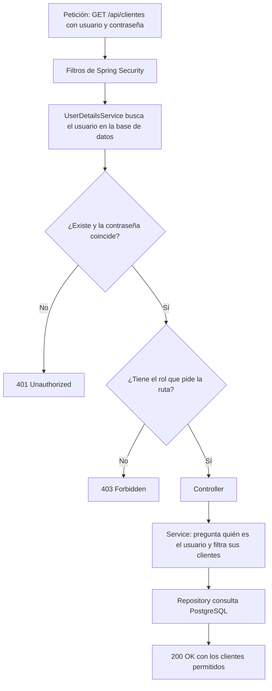

# Apuntes: seguridad en la API de clientes

Apuntes personales de la práctica de Spring Security. No forman parte de la entrega.

**Índice**

1. [Interfaces](#1-interfaces)
2. [Tablas y relaciones](#2-tablas-y-relaciones)
3. [Anotaciones JPA](#3-anotaciones-jpa)
4. [Tipo de seguridad](#4-tipo-de-seguridad)
5. [Recorrido de una petición](#5-recorrido-de-una-petición)
6. [Pasos de la práctica](#6-pasos-de-la-práctica)
7. [Usuarios de prueba](#7-usuarios-de-prueba)
8. [Progreso](#8-progreso)

> **Cómo ampliar estos apuntes:** cada tema nuevo es un apartado `##` con tres partes: la idea en una frase, una tabla o lista corta, y un "para recordar". Añádelo también al índice.

---

## 1. Interfaces

**Idea:** una interfaz dice *qué* se puede pedir, sin decir *cómo* se hace.

Es como un enchufe: la lámpara y la compañía eléctrica solo se ponen de acuerdo en la forma del enchufe. Ninguna necesita saber cómo es la otra por dentro.

**Para qué sirve**

- Cambiar una pieza sin tocar el resto.
- Tener varias versiones de lo mismo.
- Que otro escriba el código por ti.

**En esta práctica**

| Interfaz | Quién escribe el "qué" | Quién escribe el "cómo" |
|---|---|---|
| `UsuarioRepository` | Yo | Spring |
| `UserDetailsService` | Spring | Yo |
| `PasswordEncoder` | Spring | Spring (versión BCrypt) |

> **Para recordar:** interfaz = qué se puede pedir; clase = cómo se hace. En un repositorio yo escribo el *qué* y Spring pone el *cómo*.

---

## 2. Tablas y relaciones

**Idea:** tres tablas nuevas guardan quién entra, con qué rol y qué clientes ve.

| Tabla | Columnas | Para qué |
|---|---|---|
| `rol` | id, tipo_rol | `ADMIN` o `USER` |
| `usuario` | id, id_rol, usuario_login, contrasena | Quién puede entrar (contraseña hasheada) |
| `client_permission` | id, usuario, codigo_cliente, permiso | Qué clientes ve cada usuario (`READ`) |

**Relaciones**

| Relación | Clave ajena |
|---|---|
| rol 1:N usuario | `usuario.id_rol` → `rol.id` |
| usuario 1:N client_permission | `client_permission.usuario` → `usuario.usuario_login` |
| cliente 1:N client_permission | `client_permission.codigo_cliente` → `cliente.codigo` |

> **Para recordar:** el rol decide a qué *rutas* entras; `client_permission` decide qué *clientes* ves.

---

## 3. Anotaciones JPA

**Idea:** las anotaciones le dicen a Hibernate cómo encaja cada atributo con la tabla.

| Anotación | Significado |
|---|---|
| `@Entity` / `@Table` | La clase es una tabla |
| `@Id` / `@GeneratedValue` | Clave primaria, la genera la base de datos |
| `@Column(name)` | La columna se llama distinto que el atributo |
| `@Enumerated(EnumType.STRING)` | El enum se guarda como texto |
| `@ManyToOne` + `@JoinColumn` | Clave ajena convertida en objeto |
| `@OneToMany(mappedBy)` | El otro lado de la relación |

**Qué poner en `@JoinColumn`**

Sale de la línea del script `FOREIGN KEY (A) REFERENCES otra_tabla (B)`:

| Parámetro | Qué es | Cuándo se pone |
|---|---|---|
| `name = "A"` | Columna de MI tabla | Siempre |
| `referencedColumnName = "B"` | Columna de la OTRA tabla | Solo si B no es el `id` |

> **Para recordar:** `@ManyToOne` va en la clase cuya tabla tiene la columna de la clave ajena. Hibernate sabe a qué tabla apuntar por el tipo del atributo (`Rol`, `Cliente`...).

---

## 4. Tipo de seguridad

**Idea:** cuatro piezas, cada una responde a una pregunta.

| Pieza | Pregunta | Respuesta |
|---|---|---|
| HTTP Basic | ¿Cómo se identifica el cliente? | Usuario y contraseña viajan en cada petición |
| Stateless | ¿Recuerda algo el servidor? | No: sin sesión, sin cookie, sin formulario de login |
| BCrypt | ¿Cómo se comprueba la contraseña? | Se compara con el hash guardado; nunca se descifra |
| Autorización | ¿Qué puede hacer una vez dentro? | Por rol (rutas) y por permisos (clientes) |

**Códigos de respuesta**

| Código | Significado |
|---|---|
| 401 | No sé quién eres |
| 403 | Sé quién eres, pero no puedes |
| 200 | Todo correcto |

> **Para recordar:** 401 es fallo de identidad; 403 es fallo de permiso.

---

## 5. Recorrido de una petición

**Idea:** la seguridad actúa antes de llegar al controller, y el filtrado de datos después.

> **Para recordar:** puerta (filtros) → identidad (base de datos) → rol (ruta) → datos (permisos).

---

## 6. Pasos de la práctica

**Idea:** la API es un edificio de oficinas y hay que montar la recepción. Cada paso usa el anterior.

| # | Pieza | Papel en el edificio | Qué hace |
|---|---|---|---|
| 1 | Repositorios | El archivo de fichas | Buscan usuarios y permisos en la base de datos |
| 2 | `UserDetailsService` | El recepcionista | Dado un nombre, trae su ficha: login, contraseña y rol |
| 3 | `PasswordEncoder` | La comprobación | Compara la contraseña recibida con el hash |
| 4 | `SecurityFilterChain` | Las normas de la puerta | Stateless, HTTP Basic, sin CSRF, `/api/admin/**` solo ADMIN |
| 5 | Filtrado en el Service | Los despachos | Cada usuario ve solo sus clientes |
| 6 | `AdminController` | La planta de dirección | Ruta para demostrar la norma del paso 4 |
| 7 | Pruebas con `curl` | El simulacro | 401, 403 y dos 200 distintos |

> **Para recordar:** sin archivo no hay recepcionista, y sin recepcionista las normas no tienen a quién consultar.

---

## 7. Usuarios de prueba

| Usuario | Rol | Clientes que ve |
|---|---|---|
| `ana` | USER | CLI-001, CLI-003 |
| `luis` | USER | CLI-002 |
| `admin` | ADMIN | Por decidir |

Las contraseñas de prueba están en `sql/db_script.sql`.

**Las 4 pruebas del enunciado**

| # | Petición | Resultado esperado |
|---|---|---|
| 1 | `GET /api/clientes` sin credenciales | 401 |
| 2 | `GET /api/admin/...` con un USER | 403 |
| 3 | `GET /api/clientes` como Ana | 200 con CLI-001 y CLI-003 |
| 4 | `GET /api/clientes` como Luis | 200 con CLI-002 |

---

## 8. Progreso

- [x] Script de base de datos (`sql/db_script.sql`)
- [x] Dependencia `spring-boot-starter-security`
- [x] Entidades `Rol`, `Usuario` y `PermisoCliente`
- [x] Repositorios: usuario y permisos
- [x] `UserDetailsService`
- [x] `SecurityConfig`
- [PENDIENTE] Filtrar clientes y pedidos
- [ ] `AdminController`
- [ ] Pruebas con `curl` y capturas a pantalla completa
- [ ] Volcado de la base de datos
- [ ] Documentación, diagrama y ZIP
